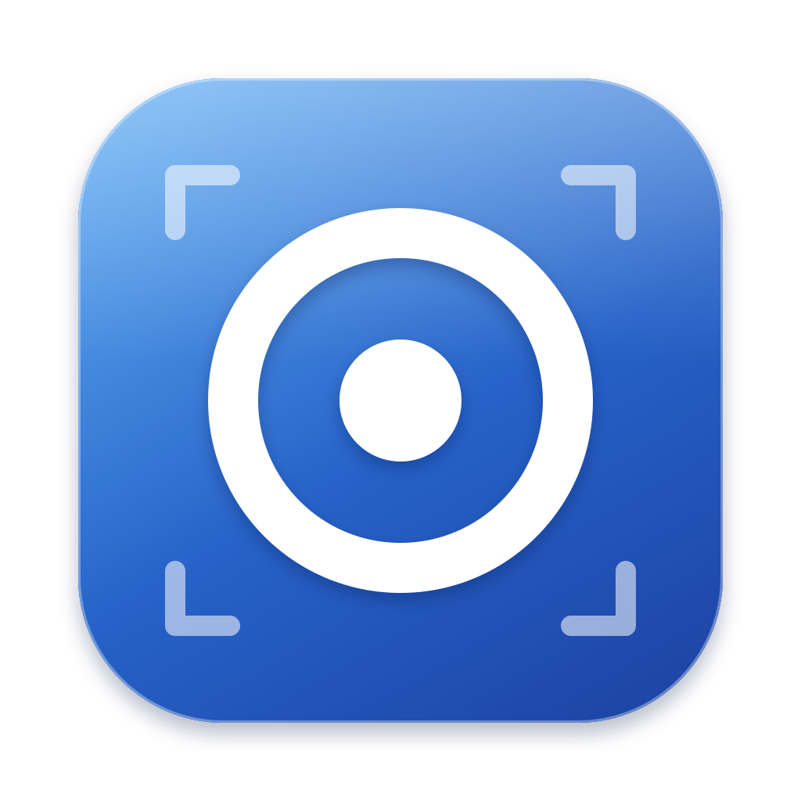
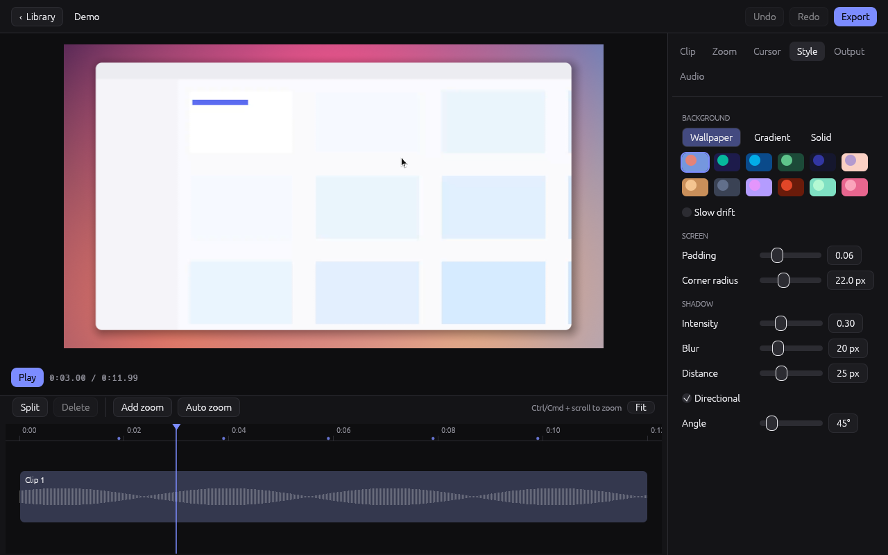
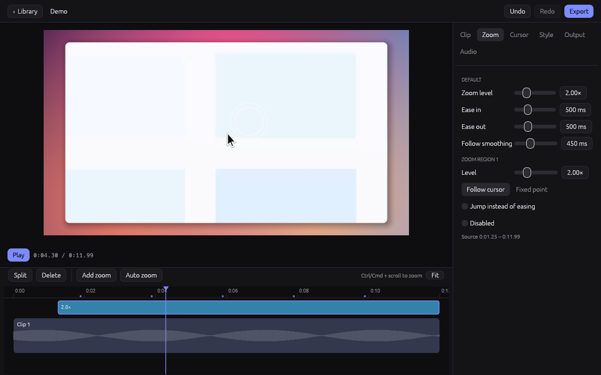
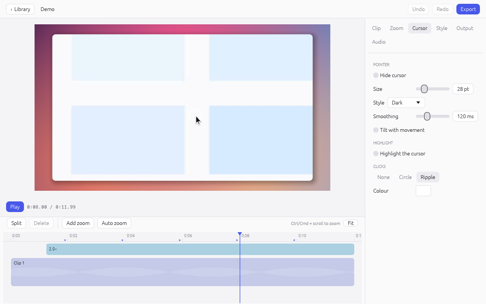
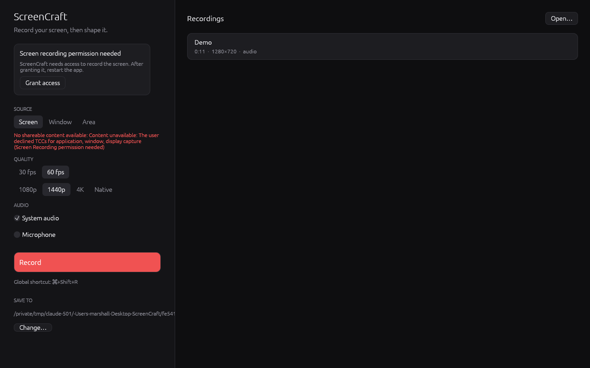

<p align="center">
  
</p>

<h1 align="center">ScreenCraft</h1>

<p align="center">
  <b>Screen recording and video editing; an open-source, from-scratch alternative to Screen Studio, built in Rust.</b><br>
  Automatic zooms that follow your cursor and typing, a smooth cursor with click effects and highlight,<br>
  non-destructive trim / split / speed, and AV1 / H.264 / VP9 export, in one native Rust app.
</p>

<p align="center">
  
  
  
  
  
  
</p>

<p align="center">
  <a href="https://github.com/MarshallNickolauson/ScreenCraft/raw/main/ScreenCraft.dmg"><b>Download for macOS</b></a> ·
  <a href="https://github.com/MarshallNickolauson/ScreenCraft/raw/main/ScreenCraft-Setup.exe"><b>Download for Windows</b></a> ·
  <a href="https://screencraft.mdnlabs.dev">Website</a> ·
  <a href="CHANGELOG.md">Changelog</a>
</p>

<p align="center">
  <a href="#screenshots">Screenshots</a> ·
  <a href="#what-it-does">Features</a> ·
  <a href="#install">Install</a> ·
  <a href="#using-it">Using it</a> ·
  <a href="#shortcuts">Shortcuts</a> ·
  <a href="#how-it-is-built">How it is built</a> ·
  <a href="#development">Development</a> ·
  <a href="#license">License</a>
</p>

<br>

> **Not affiliated.** ScreenCraft is an independent, open project that is
> *inspired by* the idea behind [Screen Studio](https://screen.studio). It is not
> affiliated with, endorsed by, or connected to Screen Studio or its makers in any
> way. "Screen Studio" is a trademark of its respective owner. ScreenCraft contains no
> code, artwork or other assets from that product.

## Screenshots

The editor, with a generated demo recording (a synthetic "app", not real footage). Zoom regions
are the blue blocks on the timeline; the waveform sits inside the clip.



Paused inside a zoom region: the camera frames the content and the click ripple and cursor are
drawn by the same shader the exporter uses.



Light theme (the app follows the system setting), cursor and click-effect settings:



The library and capture setup:



## What it does

**Recording**
- A full display, a single window or an area. Frame rate 30 / 60 and a resolution cap.
- System audio and the microphone as separate, time-aligned tracks in the same file.
- The pointer is not baked into the picture. Cursor motion, clicks and shortcuts are logged on the
  same clock so the editor can redraw, smooth and restyle them.
- A small always-on-top bar with the timer, level meters and Stop while recording, and a global
  shortcut (**⌘⇧R** on macOS, **Ctrl+Shift+R** elsewhere).

**Editing**
- **Trim / split / cut:** drag a clip's edges, press **S** to split at the playhead, **Delete** to cut
  a piece out. Per-clip speed (0.25× to 8×) and volume. Nothing is destructive: the full recording
  stays in the package, so a trim can always be extended again.
- **Zoom and pan:** automatic zoom regions from clicks and typing, or add your own. A region
  either follows the cursor or holds a fixed point you place by clicking in the preview, with
  adjustable level and ease in / out. Regions are blocks you move and resize on the timeline.
- **Cursor:** size, four styles, smoothing, tilt with movement, click effects (circle / ripple),
  and a **cursor highlight** disc under the pointer.
- **Look:** twelve procedural wallpapers (optionally drifting), gradients or solid colour, padding,
  corner radius, directional shadow, aspect ratio (auto, 16:9, 9:16, 1:1, 4:3, 3:4, 4:5, 21:9) and crop.
- **Audio:** separate system / microphone levels and mutes.
- **Undo / redo** for every edit, and autosave.

**Export**
| Container | Video | Audio |
| --- | --- | --- |
| MP4 | H.264 (VideoToolbox hardware on macOS, OpenH264 software elsewhere), AV1 (rav1e), VP9 (libvpx, optional build feature) | Opus |
| WebM | AV1, VP9 | Opus |

720p to 4K at 24 / 30 / 60 fps with three quality levels. Exports are deterministic: the same
project and settings produce the same bytes, whatever the thread count.

## Install

### macOS

**One-line install (no macOS security prompt):**

```bash
curl -fsSL https://screencraft.mdnlabs.dev/install.sh | bash
```

Or download [`ScreenCraft.dmg`](https://github.com/MarshallNickolauson/ScreenCraft/raw/main/ScreenCraft.dmg),
open it and drag **ScreenCraft** onto **Applications**. The app is ad-hoc signed (not notarised), so
macOS blocks it the first time: **System Settings → Privacy & Security → Open Anyway**, or
`xattr -dr com.apple.quarantine /Applications/ScreenCraft.app`.

Requires macOS 15 (Sequoia) or newer; developed on Apple silicon.

| Permission | Why |
| --- | --- |
| Screen Recording | capturing the display, windows and areas (required) |
| Input Monitoring | noticing shortcuts and typing for auto-zoom (optional) |
| Accessibility | following the text caret while typing (optional) |
| Microphone | only when you turn the microphone on |

macOS applies Screen Recording after a restart. The bundle is signed with a stable identity, so
permissions survive rebuilds.

### Windows

Download [`ScreenCraft-Setup.exe`](https://github.com/MarshallNickolauson/ScreenCraft/raw/main/ScreenCraft-Setup.exe).
It installs per user into `%LOCALAPPDATA%\Programs\ScreenCraft`. Capture uses DXGI Desktop
Duplication, system audio is a WASAPI loopback. The installer is unsigned, so SmartScreen may warn.

Build it yourself with Rust (MSVC toolchain, *Desktop development with C++*), CMake and NSIS:

```powershell
powershell -ExecutionPolicy Bypass -File scripts\build-windows.ps1
```

### Linux

Build from source (needs `xdg-desktop-portal` with a ScreenCast backend and PipeWire at runtime):

```bash
sudo apt install build-essential cmake pkg-config libpipewire-0.3-dev libasound2-dev \
     libclang-dev libx11-dev libxtst-dev libxi-dev libwayland-dev libxkbcommon-dev
cargo build --release -p screencraft
./target/release/screencraft
```

The portal's own dialog picks the screen or window. Pointer position comes from the stream's cursor
metadata; clicks and key shortcuts are only available on X11 (Wayland has no global input hook for
normal applications), so click-based auto-zoom needs an X11 session.

### Build from source (macOS)

```bash
git clone https://github.com/MarshallNickolauson/ScreenCraft.git
cd ScreenCraft
./scripts/bundle.sh --install     # builds a release app and copies it to ~/Applications
open ~/Applications/ScreenCraft.app
```

Needs [Rust](https://rustup.rs), CMake and the Xcode command line tools. If `libvpx` is installed
(`brew install libvpx`) the bundle is built with VP9 export. `./scripts/dmg.sh` also rebuilds
`ScreenCraft.dmg`.

## Using it

1. Pick **Screen / Window / Area**, choose audio sources, press **Record** (or the shortcut). Press
   **Stop** in the bar, or use the shortcut again.
2. The recording opens in the editor. **Auto zoom** builds zoom regions from your clicks and typing.
3. Adjust the look, trim and split, then **Export**.

Recordings live in `~/Movies/ScreenCraft` (`Videos\ScreenCraft` on Windows and Linux) as
`<name>.screencraft` folders; the location can be changed on the home screen.

### Shortcuts

`Space` play / pause · `S` split at the playhead · `Delete` remove the selected clip or zoom ·
`←` `→` step a frame · `Home` / `End` jump · `⌘Z` / `⇧⌘Z` undo / redo ·
`Ctrl/⌘ + scroll` zoom the timeline · `⌘⇧R` / `Ctrl+Shift+R` start / stop recording

## How it is built

| Crate | What it does |
| --- | --- |
| `screencraft-core` (`crates/core`) | Pure Rust: project model, spring physics, timeline mapping, auto-zoom generation, per-frame camera / cursor render track. |
| `screencraft-capture` | One `Capturer` per platform (ScreenCaptureKit, DXGI Desktop Duplication, PipeWire + portal), constant-frame-rate resampler, cursor / click / key logging. |
| `screencraft-audio` | cpal microphone and loopback streams on a shared clock, and the pure `StreamAligner` that turns timestamped blocks into gap-free 48 kHz stereo. |
| `screencraft-encode` | Sans-I/O: BGRA to I420, H.264 / AV1 / VP9 and Opus encoders, MP4 and WebM muxers that emit `WriteAt` operations, an MP4 demuxer and the `Exporter` state machine. |
| `screencraft-render` | The wgpu compositor (WGSL) and the CPU-side scene builder. Shared by the preview and the exporter. |
| `screencraft-engine` | The recording session, project packages, frame / audio sources and the export job. |
| `screencraft` (`crates/app`) | The egui application, plus `screencraft-shot`, a headless screenshot tool. |

Things worth knowing:

- **One timeline.** Every stream is stamped on a single monotonic clock; time zero is the first
  video frame, and the audio aligners pad or trim to it.
- **Sans-I/O muxing.** `Exporter` takes frames and PCM and returns `WriteAt { offset, data }`
  operations. Files, memory buffers and threads belong to the caller (`FileSink`, `MemorySink`,
  `ThreadedExporter`), which is what makes the output reproducible and easy to test.
- **The editor never previews a `<video>`.** A worker thread decodes the recording's H.264 and the
  compositor draws exactly what the exporter will.
- **Wallpapers and cursors** are generated procedurally; no third-party artwork is bundled.

A `.screencraft` package contains `screen.mp4` (H.264 video plus one Opus track per audio source),
`input.json` (cursor, clicks, keys) and `project.json`.

## Development

```bash
cargo test --workspace --release        # unit and end-to-end tests (needs a GPU adapter for render tests)
cargo run --release -p screencraft      # run the app
cargo run --release -p screencraft-engine --example make_demo -- /tmp/demo     # synthetic recording
cargo run --release -p screencraft --bin screencraft-shot -- out.png --open /tmp/demo/Demo.screencraft --dark
cargo run --release -p screencraft-engine --example export -- /tmp/demo/Demo.screencraft out.mp4 h264 1080 30
python3 scripts/gen-notices.py          # refresh THIRD-PARTY-NOTICES.md after dependency changes
```

Build with `--features vp9` (and `VPX_STATIC=1`, libvpx installed) to enable VP9.

Environment variables for testing: `SCREENCRAFT_RECORDINGS_DIR` (library folder),
`SCREENCRAFT_OPEN` (open a package at start), `SCREENCRAFT_AUTORECORD=<seconds>` (record the main
display, report, quit).

## License

This project is licensed under the MIT License. By using this software, you agree that the authors are not liable for any issues, damages, or claims arising from its use.

See [LICENSE](LICENSE) for the full text, [THIRD-PARTY-NOTICES.md](THIRD-PARTY-NOTICES.md) for the open-source
components ScreenCraft uses, and [COMPLIANCE.md](COMPLIANCE.md) for the legal and compliance guide. The
[website](https://screencraft.mdnlabs.dev) has the privacy policy, terms and cookie policy.

## Known limitations

- Hardware encoding is implemented for H.264 on macOS (VideoToolbox). Windows and Linux use the
  software encoders; the Media Foundation and VAAPI paths are not written yet.
- The Windows and Linux capture backends compile and are exercised by unit tests of their pure
  parts, but have had much less real-world testing than macOS.
- Linux: click and key logging only on X11; the portal chooser decides the source.
- Area recording is set with sliders on the home screen, not by dragging on the desktop.
- Recordings are decoded in software (OpenH264), so very large sources (5K+) scrub and export slower
  than real time.
- Not carried over from the 0.3 web UI: camera bubble, captions, annotations, key display, device
  frames, transitions, music tracks, sound effects, GIF export, compressor and update check.
- No code signing or notarisation; macOS and Windows will warn on first launch.
