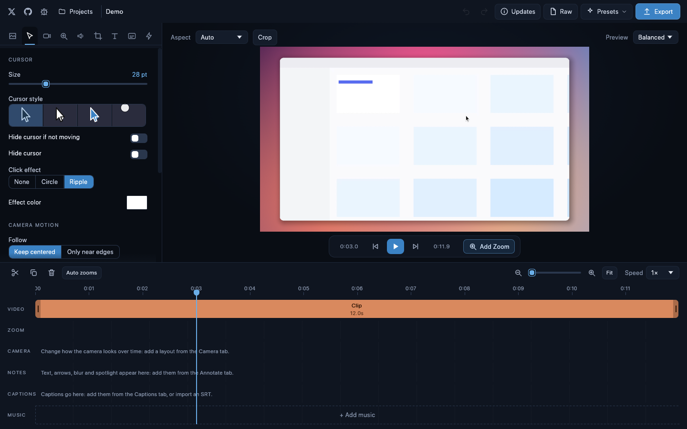
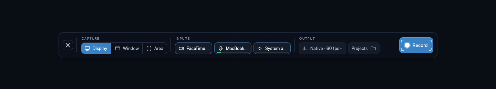

<p align="center">
  
</p>

<h1 align="center">ScreenCraft</h1>

<p align="center">
  <b>Screen recording and video editing; an open-source, from-scratch alternative to Screen Studio, built in Rust.</b><br>
  Automatic zooms that follow your cursor and typing, a camera bubble, captions, annotations,<br>
  device frames, music and sound effects, and MP4 / GIF export, in one native Rust app (no web view).
</p>

<p align="center">
  
  
  
  
  
  
</p>

<p align="center">
  <a href="https://screencraft.mdnlabs.dev/download"><b>Download for macOS</b></a> ·
  <a href="https://screencraft.mdnlabs.dev/download"><b>Download for Windows</b></a> ·
  <a href="https://screencraft.mdnlabs.dev">Website</a> ·
  <a href="CHANGELOG.md">Changelog</a>
</p>

<p align="center">
  <a href="#screenshots">Screenshots</a> ·
  <a href="#what-it-does">Features</a> ·
  <a href="#install">Install</a> ·
  <a href="#using-it">Using it</a> ·
  <a href="#shortcuts">Shortcuts</a> ·
  <a href="#how-it-is-built">How it is built</a> ·
  <a href="#development">Development</a> ·
  <a href="#license">License</a>
</p>

<br>

> **Not affiliated.** ScreenCraft is an independent, open project that is
> *inspired by* the idea behind [Screen Studio](https://screen.studio). It is not
> affiliated with, endorsed by, or connected to Screen Studio or its makers in any
> way. "Screen Studio" is a trademark of its respective owner. ScreenCraft contains no
> code, artwork or other assets from that product.

## Screenshots

The editor with a generated demo recording (a synthetic "app", not real footage): the Annotate panel,
and the six-track timeline (video, zoom, camera, notes, captions, music).


Paused inside a zoom region; the cursor and click ripple are drawn by the same shader the exporter uses.


Cursor and camera-motion settings:



The recorder bar:



## What it does

**Recording**
- A floating bar at the bottom of the screen: **Display / Window / Area** (drag out the area on the
  desktop), camera, microphone and system audio with level meters, resolution and frame rate, and a
  3-2-1 countdown. While recording it shrinks to a timer, meters, discard and Stop.
- System audio and the microphone as separate, time-aligned tracks; the camera is recorded to its own file.
- The pointer is not baked into the picture. Cursor motion, clicks and shortcuts are logged on the
  same clock so the editor can redraw, smooth and restyle them.
- Global shortcut: **⌘⇧R** on macOS, **Ctrl+Shift+R** elsewhere.

**Editing** (one window per project; unsaved edits are asked about before it closes)
- **Timeline:** video, zoom, camera, notes (annotations), captions and music tracks. Trim, split,
  reorder, duplicate, per-clip speed, idle fast-forward, speed ramps and freeze frames. Zooms are
  generated automatically the first time a recording opens.
- **Zoom and pan:** automatic regions from clicks and typing, or your own; follow the cursor or hold a point.
- **Cursor and motion:** size, four styles, smoothing, click effects, highlight, camera smoothness.
- **Appearance:** twelve procedural wallpapers (still or drifting / bokeh / waves / dust), gradient,
  colour or your own image, optional blur, padding, corners, shadow, watermark, and **device frames**
  (laptop, monitor, tablet, phone, browser).
- **Camera:** a bubble or side-by-side / large / camera-only layouts, changing over time in blocks.
- **Annotate:** text, arrows, boxes, circles, highlights, blur, pixelate and spotlight, dragged on
  the preview; on-screen **shortcut display**.
- **Captions:** on-device speech recognition with whisper.cpp (the model is downloaded once, audio
  never leaves the machine), SRT import / export, TikTok / classic / minimal styles.
- **Transitions** at cuts: dissolve, fade, flash, blur, slide, zoom.
- **Audio:** levels, **music** clips with fades and ducking under speech, and click / typing **sound effects**.
- **Crop, aspect ratio, presets, undo / redo, raw-file access and an update check.**

**Export**
| Format | Video | Audio |
| --- | --- | --- |
| MP4 | H.264 through the operating system's own encoder (VideoToolbox on macOS, Media Foundation on Windows), or AV1 (rav1e) | Opus |
| WebM | AV1 (and VP9 when built with libvpx) | Opus |
| GIF | 15 fps, up to 540 px | none |

720p to 4K at 30 / 60 fps, four quality levels, optional motion blur and an optional **compress after
export** pass. A standalone **compressor** window re-encodes any H.264 MP4 smaller. Exports of the
software codecs are deterministic. ScreenCraft bundles **no H.264 codec**; see [COMPLIANCE.md](COMPLIANCE.md).

## Install

### macOS

**One-line install (no macOS security prompt):**

```bash
curl -fsSL https://screencraft.mdnlabs.dev/install.sh | bash
```

Or download `screencraft_<version>.dmg` from the [download page](https://screencraft.mdnlabs.dev/download),
open it and drag **ScreenCraft** onto **Applications**. The app is ad-hoc signed (not notarised), so
macOS blocks it the first time: **System Settings → Privacy & Security → Open Anyway**, or
`xattr -dr com.apple.quarantine /Applications/ScreenCraft.app`.

Requires macOS 15 (Sequoia) or newer; developed on Apple silicon.

| Permission | Why |
| --- | --- |
| Screen Recording | capturing the display, windows and areas (required) |
| Input Monitoring | noticing shortcuts and typing for auto-zoom (optional) |
| Accessibility | following the text caret while typing (optional) |
| Microphone / Camera | only when you turn them on |

macOS applies Screen Recording after a restart. The bundle is signed with a stable identity, so
permissions survive rebuilds.

### Windows

Download `screencraft_<version>.exe` from the [download page](https://screencraft.mdnlabs.dev/download).
It installs per user into `%LOCALAPPDATA%\Programs\ScreenCraft`. Capture uses DXGI Desktop
Duplication, system audio is a WASAPI loopback. The installer is unsigned, so SmartScreen may warn.

Build it yourself with Rust (MSVC toolchain, *Desktop development with C++*), CMake, LLVM and NSIS;
the installer is named after the version (`screencraft_0_4_0.exe`):

```powershell
powershell -ExecutionPolicy Bypass -File scripts\build-windows.ps1
```

### Linux

Build from source (needs `xdg-desktop-portal` with a ScreenCast backend and PipeWire at runtime):

```bash
sudo apt install build-essential cmake pkg-config libpipewire-0.3-dev libasound2-dev \
     libclang-dev libx11-dev libxtst-dev libxi-dev libwayland-dev libxkbcommon-dev
cargo build --release -p screencraft
./target/release/screencraft
```

The portal's own dialog picks the screen or window. Pointer position comes from the stream's cursor
metadata; clicks and key shortcuts are only available on X11 (Wayland has no global input hook for
normal applications), so click-based auto-zoom needs an X11 session.

### Build from source (macOS)

```bash
git clone https://github.com/MarshallNickolauson/ScreenCraft.git
cd ScreenCraft
./scripts/bundle.sh --install     # builds a release app and copies it to ~/Applications
open ~/Applications/ScreenCraft.app
```

Needs [Rust](https://rustup.rs), CMake and the Xcode command line tools. If `libvpx` is installed
(`brew install libvpx`) the bundle is built with VP9 export. `./scripts/dmg.sh` also builds the
installer, `screencraft_0_4_0.dmg` (named after the version, like the Windows installer).

## Using it

1. Pick **Display / Window / Area**, choose the camera and audio inputs, press **Record** (or the
   shortcut). Press **Stop** in the bar, or use the shortcut again.
2. The recording opens in the editor with zooms already generated from your clicks and typing.
3. Adjust the look, trim and split, add annotations, captions and music, then **Export**.

Recordings live in `~/Movies/ScreenCraft` (`Videos\ScreenCraft` on Windows and Linux) as
`<name>.screencraft` folders; the location can be changed from the **Projects** menu. 0.3 recordings
open as they are.

### Shortcuts

`Space` play / pause (hold for 2×) · `S` split · `Z` add a zoom · `Delete` remove the selection ·
`⌘D` duplicate · `Q` / `E` start / end · `A` / `D` previous / next zoom · `←` `→` step a frame ·
`⌘Z` / `⇧⌘Z` undo / redo · `⌘S` save · `⌘E` export · `⌘A` select all zooms ·
`Ctrl/⌘ + scroll` zoom the timeline · `⌘⇧R` / `Ctrl+Shift+R` start / stop recording

## How it is built

| Crate | What it does |
| --- | --- |
| `screencraft-core` (`crates/core`) | Pure Rust: project model, spring physics, timeline mapping, auto-zoom generation, per-frame camera / cursor render track. |
| `screencraft-capture` | One `Capturer` per platform (ScreenCaptureKit, DXGI Desktop Duplication, PipeWire + portal), constant-frame-rate resampler, cursor / click / key logging. |
| `screencraft-audio` | cpal microphone and loopback streams on a shared clock, and the pure `StreamAligner` that turns timestamped blocks into gap-free 48 kHz stereo. |
| `screencraft-encode` | Sans-I/O: BGRA to I420, AV1 / VP9 and Opus encoders, the operating system's H.264 (VideoToolbox / Media Foundation), MP4 and WebM muxers that emit `WriteAt` operations, an MP4 demuxer (including fragmented MP4) and the `Exporter` state machine. |
| `screencraft-render` | The wgpu compositor (WGSL), the CPU-side scene builder and the tiny-skia overlays (device frames, annotations, captions). Shared by the preview and the exporter. |
| `screencraft-engine` | The recording session (screen, audio, camera), project packages, frame / audio sources, the soundtrack mixer, and the export, GIF and compressor jobs. |
| `screencraft` (`crates/app`) | The egui application, plus `screencraft-shot`, a headless screenshot tool. |

Things worth knowing:

- **One timeline.** Every stream is stamped on a single monotonic clock; time zero is the first
  video frame, and the audio aligners pad or trim to it.
- **Sans-I/O muxing.** `Exporter` takes frames and PCM and returns `WriteAt { offset, data }`
  operations. Files, memory buffers and threads belong to the caller (`FileSink`, `MemorySink`,
  `ThreadedExporter`), which is what makes the output reproducible and easy to test.
- **No web view.** The whole UI is egui; a worker thread decodes the recording and the compositor
  draws exactly what the exporter will.
- **No bundled H.264.** Encoding and decoding use the operating system's licensed codec.
- **Wallpapers and cursors** are generated procedurally; no third-party artwork is bundled.

A `.screencraft` package contains `screen.mp4` (H.264 video plus one Opus track per audio source),
`camera.mp4` (when the camera was on), `input.json` (cursor, clicks, keys), `project.json` and any
music files you added.

## Development

```bash
cargo test --workspace --release        # unit and end-to-end tests (needs a GPU adapter for render tests)
cargo run --release -p screencraft      # run the app
cargo run --release -p screencraft-engine --example make_demo -- /tmp/demo     # synthetic recording
cargo run --release -p screencraft --bin screencraft-shot -- out.png --open /tmp/demo/Demo.screencraft --dark
cargo run --release -p screencraft-engine --example export -- /tmp/demo/Demo.screencraft out.mp4 h264 1080 30
python3 scripts/gen-notices.py          # refresh THIRD-PARTY-NOTICES.md after dependency changes
```

Build with `--features vp9` (and `VPX_STATIC=1`, libvpx installed) to enable VP9.

Environment variables for testing: `SCREENCRAFT_RECORDINGS_DIR` (library folder),
`SCREENCRAFT_OPEN` (open a package at start), `SCREENCRAFT_AUTORECORD=<seconds>` (record the main
display, report, quit).

## License

This project is licensed under the MIT License. By using this software, you agree that the authors are not liable for any issues, damages, or claims arising from its use.

See [LICENSE](LICENSE) for the full text, [THIRD-PARTY-NOTICES.md](THIRD-PARTY-NOTICES.md) for the open-source
components ScreenCraft uses, and [COMPLIANCE.md](COMPLIANCE.md) for the legal and compliance guide. The
[website](https://screencraft.mdnlabs.dev) has the privacy policy, terms and cookie policy.

## Known limitations

- Windows and Linux are much less tested than macOS. The Windows H.264 path (Media Foundation) is new.
- Linux has no operating-system H.264, so recordings cannot be edited there yet; click and key
  logging works only on X11.
- HEVC export / compression is not built; the compressor reads H.264 MP4s and carries Opus audio only.
- Large sources (5K+) decode slower than real time when scrubbing.
- No code signing or notarisation; macOS and Windows will warn on first launch.
