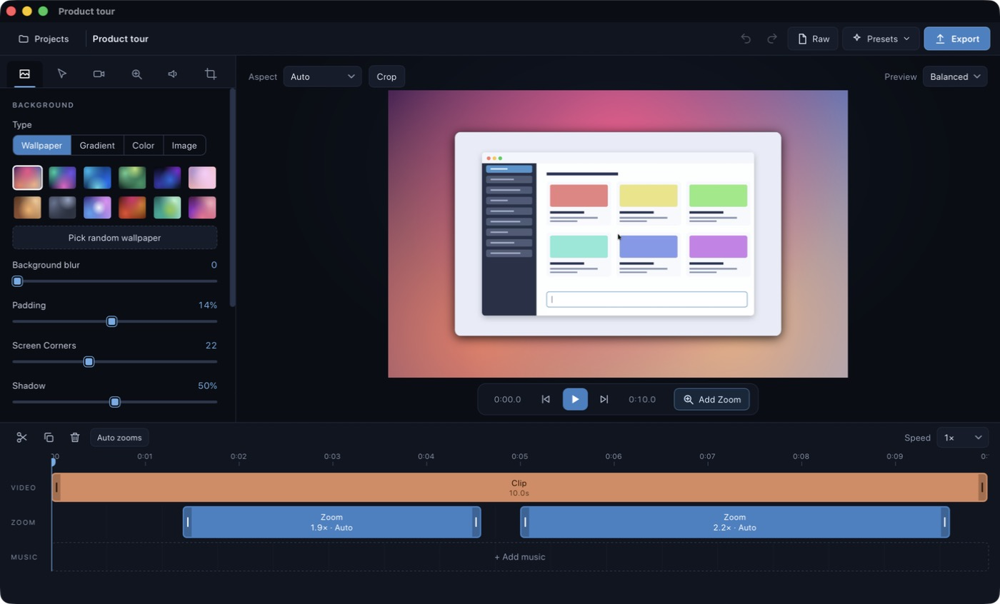
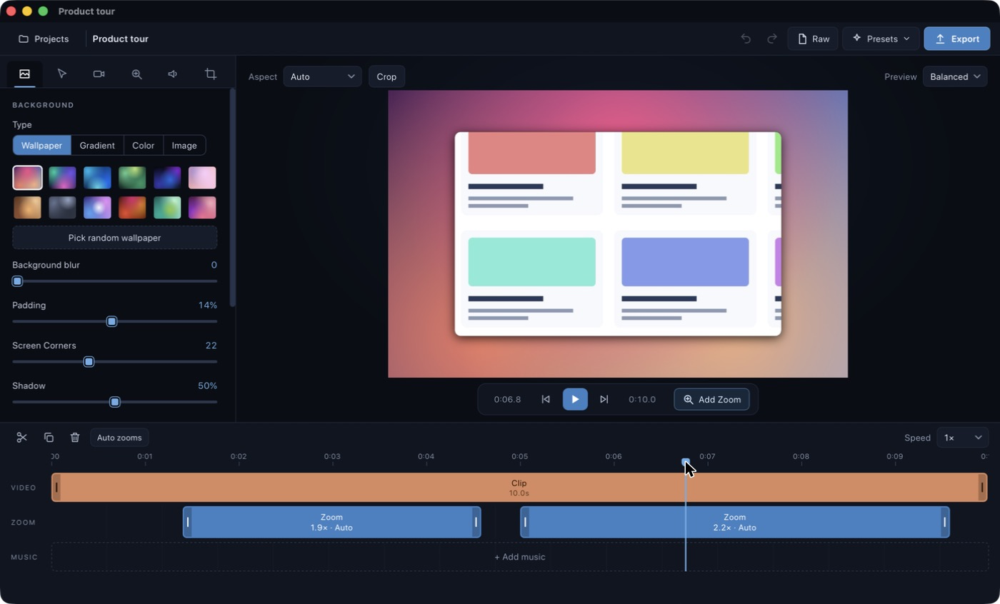
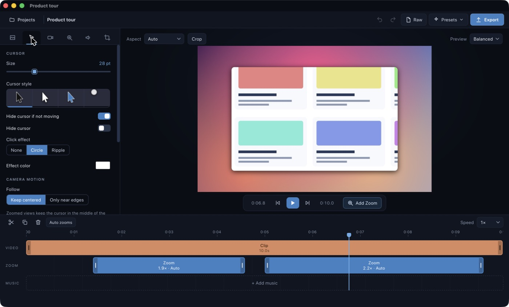
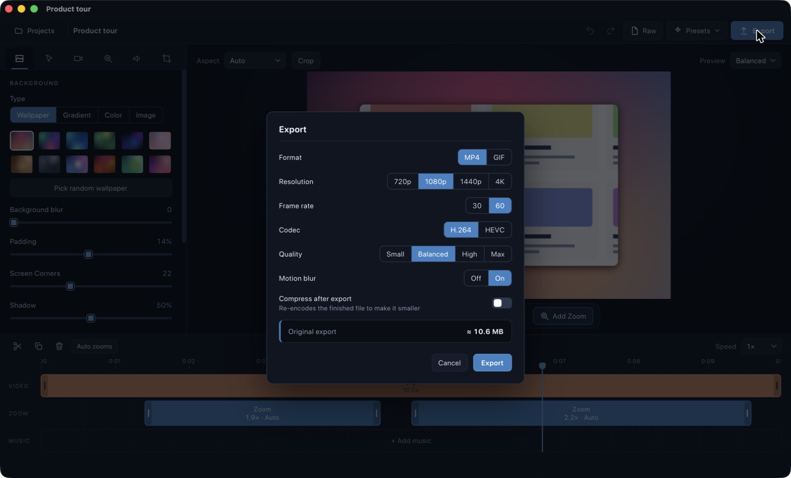
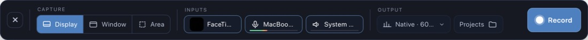

# ScreenCraft

A screen recorder and video editor for macOS and Windows, written in Rust. Record your display,
a window or an area (with an optional camera bubble, microphone and system audio),
then turn the raw capture into a polished video: smooth automatic zooms that follow
your cursor and typing, restyled cursor, backgrounds, rounded corners, shadows,
cuts, speed changes, background music and MP4 / GIF export.

There are no AI features: just recording, camera, editing and zoom.

> **Not affiliated.** ScreenCraft is an independent, open project that is
> *inspired by* the idea behind [Screen Studio](https://screen.studio). It is not
> affiliated with, endorsed by, or connected to Screen Studio or its makers in any
> way. "Screen Studio" is a trademark of its respective owner. ScreenCraft contains no
> code, artwork or other assets from that product.

## Screenshots

The editor, with a generated demo recording (a synthetic "app" with a typing
box, not real footage). Zoom regions are the blue blocks on the timeline.



Paused inside a zoom: the camera is framing the cards and the preview re-fetches a
full-resolution frame so zoomed stills stay sharp.



Cursor and camera-motion settings:



Export, with optional compress-after-export and a size estimate:



The recorder bar: capture mode, camera / microphone / system audio with level
meters, resolution and frame rate, and the project list.



## What it does

**Recording**
- Capture a full display, a single window, or a dragged area (the area outside it is
  dimmed so you can see what is being recorded).
- Camera bubble, microphone and system audio, each with a device picker and a live
  level meter. Choose resolution (Native / 2560 / 1920 / 1600 / 1280) and 30 or 60 fps.
- The system cursor is not baked into the video, so it can be redrawn, smoothed and
  restyled in the editor. Clicks, cursor motion and keystrokes are logged alongside.
- Draggable recording HUD, countdown, global shortcut **⌘⇧2** (**Ctrl+Shift+2** on Windows), menu-bar controls.

**Editing**
- **Zoom:** automatic zoom regions generated from your clicks and typing, with
  adjustable ease in / ease out, plus manual zooms you can place anywhere. The camera
  keeps the cursor near the centre and, while you type, follows the text caret.
- **Timeline:** video, zoom, camera, notes, captions and music tracks. Split, trim, reorder, duplicate and
  delete clips; change speed per clip; drag zoom regions and music clips freely. Zoom
  the timeline itself in and out (slider, **Fit**, or ⌘/Ctrl + scroll) to work on a long
  recording, and shift-click several zoom blocks to edit their settings together.
- **Workspace:** drag the divider above the timeline and the divider beside the side panel
  to give the area you are working in more room (double-click a divider to reset).
- **Playback:** **Space** toggles play / pause; hold it to play at 2× while it is held.
- **Annotate:** text titles, arrows, boxes, circles and highlights; **blur**, **pixelate**
  and **spotlight** regions that stay pinned to the recording while the camera zooms; drag
  them on the preview. A **shortcut display** pops up keys like ⌘C or Esc as you press
  them (recordings made with this version or newer).
- **Camera layouts:** a Camera track changes how the camera is shown over time: large
  bubble, camera only, side by side (either side) or camera off, eased between.
- **Captions:** type them or import an SRT; the default is TikTok-style (heavy white text with
  a black outline in the middle of the bottom third), with red, highlight, classic and
  minimal looks; export your captions back to SRT.
- **Pace:** speed up idle stretches (found from clicks, typing, cursor motion and, if you
  like, when you talk), ease speed changes into smooth ramps, freeze a frame for a
  moment, and add cut transitions (true cross-dissolve, fade, flash, blur, slide, zoom).
- **Look:** wallpapers, gradients, solid colours or your own image (with blur),
  padding, corner radius, shadow, aspect ratio, crop.
- **Cursor:** several styles, click effects, hide-when-idle, hides while you type.
- **Camera bubble:** size, shape, nine anchor positions (optionally flush to the frame
  edge, ignoring the padding), mirror, border, and it shrinks smoothly while the view is
  zoomed in.
- **Audio:** separate mic / device / music / master levels. The microphone is
  levelled and centred automatically.
- **Sound effects:** optional built-in mouse-click and keyboard-typing sounds, placed on
  the recorded clicks and key presses, each with a few styles and its own volume. They
  are synthesised by `scripts/make-sounds.py`, so they are original and licence-free.
- **Music:** add an audio file, trim and split it, see its waveform on the track, fade it
  in and out, and have it lower itself while you speak.
- **Project files:** edits stay in memory until you save (**⌘S**); a `*` in the title
  shows unsaved changes and closing or quitting asks before discarding them.

**Export & compression**
- MP4 (H.264 / HEVC) or GIF at 720p – 4K, 30 / 60 fps, with a size estimate.
- Optional *compress after export* (HandBrake-style presets via AVFoundation), with
  the choice to keep the original, the compressed copy, or both.
- A standalone **Compress Video…** tool for any video file.

## Install

### macOS

Download [`ScreenCraft.dmg`](ScreenCraft.dmg) from the root of this repository, open
it and drag **ScreenCraft** onto **Applications**. The app is only ad-hoc signed (not
notarised), so the first time you open it use right-click → **Open**.

Requires macOS 15 (Sequoia) or newer; developed and tested on Apple silicon.

**Permissions.** On first launch a setup window checks the macOS permissions the app
needs and takes you to the right System Settings pane:

| Permission | Why |
| --- | --- |
| Screen Recording | capturing the display, windows and areas (required) |
| Accessibility | finding the text caret so the camera can follow your typing (required) |
| Input Monitoring | noticing when you start typing (required) |
| Camera / Microphone | only if you use the camera bubble or narration |

macOS applies Screen Recording and Input Monitoring after the app restarts; the
window offers a restart button. The app is signed ad hoc with a stable identity, so
permissions persist across rebuilds.

### Windows

Windows 10 / 11 is supported (added in
[PR #1](https://github.com/MarshallNickolauson/ScreenCraft/pull/1) by
[@PierrunoYT](https://github.com/PierrunoYT)). Recording (display, window or area,
with camera, microphone and system audio), editing and exporting all work; no
permissions setup is needed. Capture uses Windows.Graphics.Capture, decoding and
encoding go through Media Foundation (hardware H.264 where available), system audio
comes from a WASAPI loopback, and the recording shortcut is **Ctrl+Shift+2**.

Download [`ScreenCraft-Setup.exe`](ScreenCraft-Setup.exe) from the root of this
repository and run it. It installs per user (no administrator rights) into
`%LOCALAPPDATA%\Programs\ScreenCraft` with Start Menu and Desktop shortcuts, an entry
in *Settings → Apps*, and fetches the WebView2 runtime from Microsoft if it is missing
(it ships with Windows 11). The installer is unsigned, so SmartScreen may warn: choose
*More info → Run anyway*.

**Build it yourself** on a Windows PC (a few minutes the first time). You need
[Rust](https://rustup.rs) with the MSVC toolchain, which needs the *Desktop development
with C++* workload from the
[Visual Studio Build Tools](https://visualstudio.microsoft.com/downloads/), and
[NSIS](https://nsis.sourceforge.io) (`winget install NSIS.NSIS`). Then, in PowerShell,
from the repository root:

```powershell
git clone https://github.com/MarshallNickolauson/ScreenCraft.git
cd ScreenCraft
powershell -ExecutionPolicy Bypass -File scripts\build-windows.ps1
```

This builds a release binary, writes `ScreenCraft-Setup.exe` in the repository root and
prints its SHA-256. To run from source without installing, use
`cargo run --release -p screencraft`.

The standalone compressor (and compress-after-export) is not available on Windows yet,
and typing focus follows the text caret only in apps that expose a classic Win32 caret;
elsewhere it is estimated from keystrokes.

### Build from source (macOS)

```bash
git clone https://github.com/MarshallNickolauson/ScreenCraft.git
cd ScreenCraft
./scripts/bundle.sh --install     # builds a release app and copies it to ~/Applications
open ~/Applications/ScreenCraft.app
```

Needs [Rust](https://rustup.rs) (stable) and the Xcode command line tools
(`xcode-select --install`). `./scripts/bundle.sh` without `--install` leaves the app at
`dist/ScreenCraft.app`; `./scripts/dmg.sh` also rebuilds `ScreenCraft.dmg`. The first
release build takes a few minutes. The app icon is rendered by `scripts/make-icon.swift`.

## Using it

1. Pick **Display / Window / Area**, choose camera and audio sources, press **Record**
   (or **⌘⇧2**). Press **Stop** in the HUD or use the shortcut again.
2. The recording opens in the editor. The first open builds a smooth preview copy of
   the footage, which takes a little while for long recordings and is then reused.
3. Adjust zooms, look and audio; add music if you like; **⌘S** to save.
4. **Export** (top right). Files go to `~/Movies` by default.

Projects live in `~/ScreenCraft Projects/<name>.screencraft` and can be renamed by
clicking the title in the editor.

### Shortcuts

`Space` play / pause (hold for 2×) · `Esc` close the open dialog · `S` split at playhead · `Z` add zoom · `D` duplicate ·
`⌫` delete selection · `←` `→` step · `⌘Z` / `⇧⌘Z` undo / redo · `⌘S` save ·
`⌘⇧2` start / stop recording

## How it is built

| Piece | Where | What it does |
| --- | --- | --- |
| `screencraft-core` | `crates/core` | Pure Rust: project model, spring physics, timeline mapping, auto-zoom generation and the per-frame camera / cursor render track. Unit tested. |
| App shell | `src-tauri` | Tauri 2 app: capture, input and caret tracking, project IO, native preview proxy and frame server, audio levelling, compression, windows and menus. Platform code lives in per-feature folders (`capture/`, `proxy/`, `srcframes/`, `jpegio/`, `inputlog/`, `meter/`, `compress/`) with `macos.rs` (ScreenCaptureKit, AVFoundation, ImageIO) and `windows.rs` (Windows.Graphics.Capture, Media Foundation, WIC) backends. |
| UI | `ui` | Plain ES modules, no bundler: recorder bar, editor, canvas compositor and timeline. Exports with WebCodecs. |

Some details worth knowing:

- **Preview proxy.** The editor never plays a `<video>` element. Rust decodes the
  recording once into a small JPEG strip next to the project and serves frames on
  demand over a custom `sc://` scheme; audio is decoded and scheduled with WebAudio.
  This avoids a WebKit / AVFoundation player deadlock and makes scrubbing instant.
  Paused frames are re-fetched at full resolution.
- **Export** reads full-resolution source frames natively, paints them with the same
  compositor code as the preview, and encodes with WebCodecs plus a bundled MP4
  muxer (`ui/vendor`, MIT). No ffmpeg is required.
- **Wallpapers** are generated procedurally; no third-party artwork is bundled.

A `.screencraft` package contains `screen.mp4`, optional `camera.mp4` and `mic.m4a`,
`input.json` (cursor, clicks, keys, caret), `project.json`, and generated
`proxy-*` / `mic-leveled-*` cache files that are safe to delete.

## Development

```bash
cargo test -p screencraft-core     # unit tests for the core crate
python3 scripts/make-sounds.py     # regenerate the click / typing sounds (needs numpy)
cargo check -p screencraft         # type-check the app
./scripts/bundle.sh --install      # rebuild and reinstall
```

## License

MIT, see [LICENSE](LICENSE).

## Known limitations

- macOS and Windows only. The two ports share the UI and `screencraft-core`; native capture, decoding and encoding are separate per-platform modules (see below).
- Windows: no standalone compressor yet, and the installer is unsigned.
- Preview proxies are large (roughly 2–3 MB per second of recording); delete the
  `proxy-*` files in a project folder to reclaim space.
- Export is not real-time; long 60 fps projects take a while.
- Typing focus depends on the focused app exposing its text caret through
  Accessibility; otherwise the position is estimated from keystrokes.
- No code signing or notarisation, so you build it yourself.
